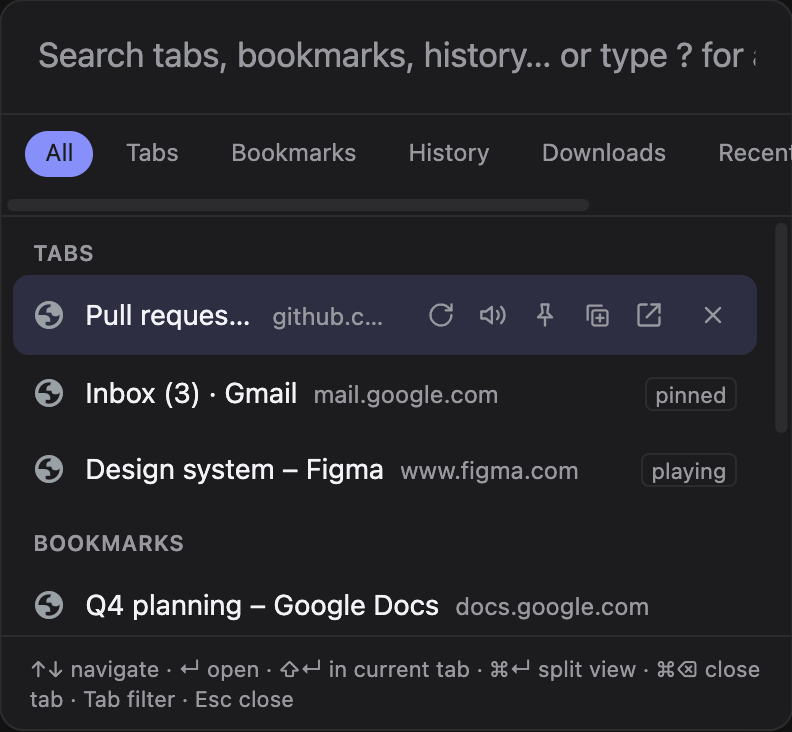

<div align="center">

# Tabkit

**One keystroke for your whole browser.**
A command palette for Chromium: tabs, bookmarks, history, page tools, instant answers and AI chat behind <kbd>⌘K</kbd>.



</div>

## Why Tabkit

- **Find anything**: tabs, bookmarks, history, downloads and recently closed tabs, fuzzy-matched and grouped by kind.
- **Act without the mouse**: pin, mute, reload, move to split view or close straight from a result row.
- **Answers as you type**: math, units, time zones, colours and more, copied with <kbd>Enter</kbd>.
- **Small tools built in**: emoji picker, to-dos, RSS reader, weather.
- **AI chat**: Claude, ChatGPT, Gemini, local Ollama and more, with the current page as context.
- **Yours to style**: 16 themes, three layouts, a custom accent.

## Quick start

```sh
npm install
npm run build    # -> .output/chrome-mv3, load via chrome://extensions → Load unpacked
```

Press <kbd>⌘K</kbd> / <kbd>Ctrl+K</kbd> on any normal page. On chrome:// pages use <kbd>⌘⇧K</kbd> /
<kbd>Ctrl+Shift+K</kbd> or the toolbar icon; the palette opens in its own window there.

## Features

### Search & prefixes

| Prefix | Searches | Prefix | Searches |
| --- | --- | --- | --- |
| `:t` | tabs + commands | `:p` | pinned |
| `:b` | bookmarks | `:c` | commands |
| `:h` | history | `:s` | web search |
| `:d` | downloads | `:ss` | screenshots |
| `:r` | recently closed | `:cp` | colour picker |
| `:rl` | ruler | | |

Type `?` (or `:`) to list them; the Tools tab lists every tool. Results are grouped by kind with matched
letters highlighted.

- **Downloads** (`:d`, not in the default list): rows show size or Downloading… / Failed / File missing.
  <kbd>Enter</kbd> opens the file (or its folder); row buttons show it in its folder, copy the source URL or
  remove the entry (the file stays).
- **Recently closed** (`:r`): rows show how long ago; the default list shows the last 5. Type `undo` to
  reopen the last one.
- **Web search** rows come last, one per engine enabled in Settings (Google, Bing, DuckDuckGo by default;
  Yahoo, Brave optional).

### Tabs, groups & split view

Bookmarks, history, downloads, recently closed and tab groups are optional permissions. Settings opens on
install so you can switch them on (Settings → Data sources); turning one off gives the permission back.

- With tab groups on (Chrome; Edge doesn't offer it), grouped tabs show a badge in the group's colour. Any
  grouped tab row has a "Remove from group" button, as does the `group` command.
- <kbd>⌘↵</kbd> / <kbd>Ctrl+Enter</kbd> on a tab row (or its split button) opens it in Chrome's split view
  beside the current tab (Chrome 155+). A split tab's row has an "Undo split view" button, as does the
  "Undo split view of current tab" command.

### Page commands

Listed most-used first (`:c` or just type): zoom, hard reload, print, scroll, view source, full screen, copy
URL / title / Markdown link, open in incognito, QR code, colour picker, ruler, and screenshots (visible /
selected area / full page → copy or save PNG).

### Instant answers

Just type; <kbd>Enter</kbd> copies.

| Kind | Try |
| --- | --- |
| Math | `sqrt(144) * 2`, `200 + 10%`, `15% of 80` |
| Units | `5 km to mi`, `32px to rem`, `1.5 GB to MB`, `100 f to c` |
| Time | `time in tokyo`, `now + 3 days`, unix timestamps |
| Colours | `#f80`, `rgb(…)`, `hsl(…)` |
| Bases | `0xff`, `10 to binary` |
| Text | `:tx <text>` (case conversion), `:uuid`, `:pwd [length]` |

### Tools

- **`:em` emoji**: grid grouped by category with a preview header and six skin-tone swatches. <kbd>Enter</kbd>
  copies, <kbd>Shift+Enter</kbd> copies `:code:`, <kbd>Esc</kbd> goes back to Tools; the last 32 picks sit on top.
- **`:todo` / `:td` to-do list**: type to add, <kbd>Enter</kbd> checks off.
- **`:rss` reader**: six preset feeds; paste a feed URL to add one.
- **`:wx` weather** via Open-Meteo: type a city to add (up to 15); type a saved city's name for its 7-day
  forecast. °C unless you pick °F in Settings.

<kbd>⌘⌫</kbd> / <kbd>Ctrl+Backspace</kbd> deletes a to-do, feed or place. To-dos, feeds and places sync
through `chrome.storage.sync`.

### AI chat

`:ai <message>` streams an answer.

- <kbd>Enter</kbd> on an empty prompt copies the last answer; <kbd>Tab</kbd> switches provider/preset (each
  keeps its own history); <kbd>⌘⌫</kbd> clears the chat; `@page` attaches the current page's text.
- Answers render as Markdown (raw HTML shown as text, only http(s)/mailto links, images as links).
- Providers: Claude (Anthropic SDK), ChatGPT, Gemini, Grok, Groq, DeepSeek, Mistral, Perplexity, OpenRouter
  (OpenAI-compatible) and Ollama/local servers (no key; the extension strips its `Origin` header on
  localhost so Ollama accepts it without `OLLAMA_ORIGINS`).
- Keys live in `chrome.storage.local`.

### Settings

Open with the command "Tabkit settings" or the extension's options page.

- 16 themes plus System, and an accent colour for System/Light/Dark (browsers don't expose their theme
  colours to extensions).
- Palette / Spotlight / Notch layouts, previewed live.
- The in-page shortcut, which filter tabs show, and sites where the shortcut is off (also the
  "Disable / enable the palette shortcut on this site" command).
- AI keys, models and presets.

Everything except keys syncs through `chrome.storage.sync`.

### Commands from other extensions

Another extension can add its own commands to the palette (Markboard does). It sends
`{ type: 'tabkit:register', name }` to Tabkit's id; on each palette load Tabkit asks it with
`{ type: 'tabkit:commands' }` (reply: `{ id, title }[]`) and runs a picked one with
`{ type: 'tabkit:run', command, tabId }`. `{ type: 'tabkit:open' }` opens the palette over the sender's own page.
Titles are shown as `<name>: <title>`, so don't prefix them yourself. A provider has 300 ms to answer or is
skipped for that load; one whose messages fail (uninstalled, disabled, mid-update) is forgotten, so register again
on startup or whenever your UI opens. See `lib/providers.ts`.

## Development

WXT + Svelte 5.

```sh
npm run dev        # opens a dev browser with the extension and hot reload
npm run build      # -> .output/chrome-mv3
npm test           # search/prefix logic
npm run check      # type-check
npm run lint       # ESLint (TypeScript + Svelte rules)
npm run verify     # check + lint + test + build; the git pre-commit hook and CI run this
npm run build:e2e  # test build: data-source permissions granted, no Settings tab on install
npm run icons      # assets/icon.svg -> public/icon/{16,32,48,128}.png (needs rsvg-convert)
```

## Layout

- `background.ts` does all the browser API work (one handler per message; pages reach it through the typed
  `send()` in `lib/messages.ts`).
- `lib/commands.ts` has the tab commands; `lib/prefixes.ts` is the one table of `:` prefixes and their parse;
  `lib/query.ts` does the fuzzy ranking (both pure, tested).
- `components/Palette.svelte` is the UI (its key and chip logic is the pure `step()` in `lib/palette.ts`).
- `lib/page.ts` has page commands and screenshots; `ruler.content.ts` is the ruler overlay.
- `lib/tools.ts` has the pure tool logic (tested) and `lib/toolbox.ts` the storage/network side, which runs
  in the background: one module per tool in `lib/toolbox/`, picked by the row's kind.
- `lib/settings.ts` holds settings, themes and the provider catalog; `lib/ai.ts` streams chats over a
  runtime port.
- `lib/providers.ts` lists and runs other extensions' commands (pure parts tested).
- `components/Chat.svelte` and `components/Options.svelte` are the chat view and settings page.
- `hotkey.content.ts` is the only script that runs on every page; the palette is injected only when you
  open it.

## License

MIT, see [LICENSE](LICENSE).
